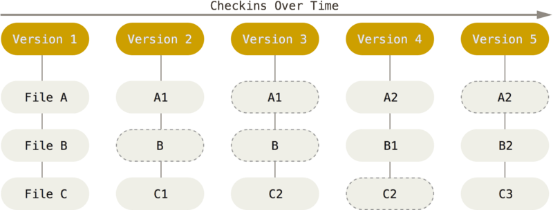
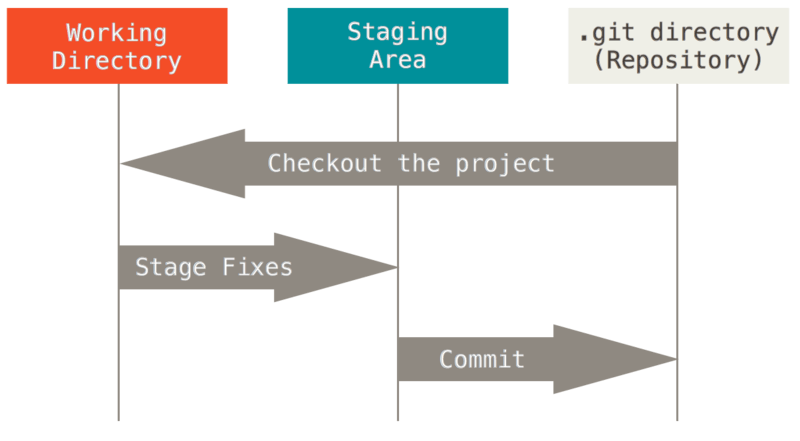
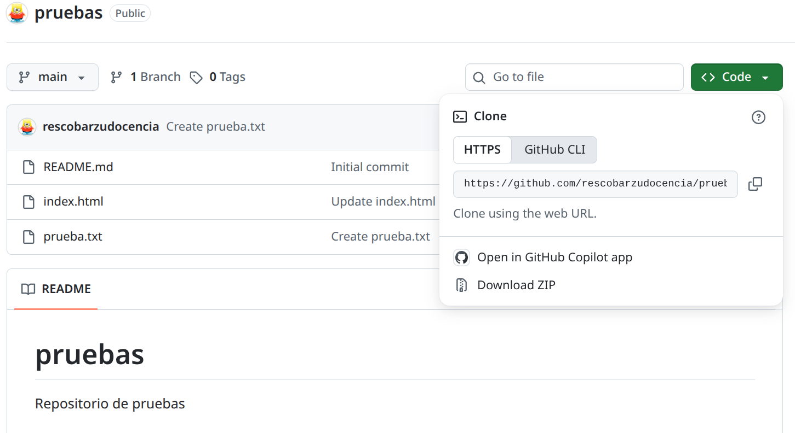
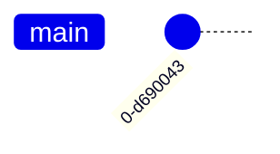

# UT5 Control de Versiones. GIT. <!-- omit in toc -->
---


- [1. Introducción.](#1-introducción)
- [2. Estados de los ficheros en Git.](#2-estados-de-los-ficheros-en-git)
- [3. Aspectos básicos.](#3-aspectos-básicos)
  - [3.1. Instalación de Git.](#31-instalación-de-git)
  - [3.2. Configurando Git por primera vez.](#32-configurando-git-por-primera-vez)
  - [3.3. ¿Cómo obtener ayuda?](#33-cómo-obtener-ayuda)
- [4. Uso básico de Git.](#4-uso-básico-de-git)
  - [4.1. Como crear un repositorio.](#41-como-crear-un-repositorio)
  - [4.2. Clonado de un repositoro.](#42-clonado-de-un-repositoro)


# 1. Introducción.

Esta documentación es un resumen de la documentación oficial de Git que podemos encontrarla en esl siguiente enlace https://git-scm.com/book/es/v2.

Taller de Git del aula del software Libre de la Universidad de Cordoba : https://aulasoftwarelibre.github.io/taller-de-git/


¿Qué es un control de versiones, y por qué debería importarte? Un control de versiones es un sistema que registra los cambios realizados en un archivo o conjunto de archivos a lo largo del tiempo, de modo que puedas recuperar versiones específicas más adelante. Aunque en los ejemplos  vamos a ver archivos de código fuente como aquellos cuya versión está siendo controlada, en realidad **puedes hacer lo mismo con casi cualquier tipo de archivo** que encuentres en una computadora.

Git maneja sus datos como un conjunto de copias instantáneas de un sistema de archivos miniatura. Cada vez que confirmas un cambio, o guardas el estado de tu proyecto en Git, él básicamente toma una foto del aspecto de todos tus archivos en ese momento y guarda una referencia a esa copia instantánea. Para ser eficiente, si los archivos no se han modificado Git no almacena el archivo de nuevo, sino un enlace al archivo anterior idéntico que ya tiene almacenado. Git maneja sus datos como una secuencia de copias instantáneas.



# 2. Estados de los ficheros en Git.

Git tiene tres estados principales en los que se pueden encontrar tus archivos: modificado (modified), preparado (staged) y confirmado (committed)

+ **Modificado**: significa que has modificado el archivo pero todavía no lo has confirmado a tu base de datos. 
+ **Preparado**: significa que has marcado un archivo modificado en su versión actual para que vaya en tu próxima confirmación.
+ **Confirmado**: significa que los datos están almacenados de manera segura en tu base de datos local. 



El flujo de trabajo básico en Git es algo así:

1. Modificas una serie de archivos en tu directorio de trabajo.

2. Preparas los archivos, añadiéndolos a tu área de preparación.

3. Confirmas los cambios, lo que toma los archivos tal y como están en el área de preparación y almacena esa copia instantánea de manera permanente en tu directorio de Git.

# 3. Aspectos básicos.

## 3.1. Instalación de Git.

+ **Instalación Linux**.
  
  Dependiendo de la distribución de Linux y su sistema de gestión de paquetes, en el siguiente enlace vienen los comandos para instlarlo dependiendo de la distribución que estemos usando.
  
  https://git-scm.com/install/linux

+ **Instalación windows**.

   En el siguiente enlace nos descargamos la versión de nuestro Windows:

   https://git-scm.com/install/windows

+ **Instalación en Mac**.
  
  https://git-scm.com/install/mac


Una vez instalada podemos ver la versión con el comando:
```bash
git --version
```

## 3.2. Configurando Git por primera vez.

Lo primero que deberás hacer cuando instales Git es establecer tu nombre de usuario y dirección de correo electrónico. Esto es importante porque los "commits" de Git usan esta información, y es introducida de manera inmutable en los commits que envías:

```bash
git config --global user.name "John Doe"
git config --global user.email johndoe@example.com
```

> Tu Editor

Ahora que tu identidad está configurada, puedes elegir el editor de texto por defecto que se utilizará cuando Git necesite que introduzcas un mensaje. Si no indicas nada, Git usará el editor por defecto de tu sistema, que generalmente es Vim. Si quieres usar otro editor de texto como Emacs, puedes hacer lo siguiente:

```bash
git config --global core.editor emacs
```
> Comprobando tu Configuración

Si quieres comprobar tu configuración, puedes usar el comando git config --list para mostrar todas las propiedades que Git ha configurado:

```bash
git config --list
```
También puedes comprobar el valor que Git utilizará para una clave específica ejecutando `git config <key>`.

```bash
git config user.name
John Doe
```

## 3.3. ¿Cómo obtener ayuda?
Si alguna vez necesitas ayuda usando Git, existen tres formas de ver la página del manual (manpage) para cualquier comando de Git:
```bash
git help <verb>
git <verb> --help
man git-<verb>
```
Por ejemplo, puedes ver la página del manual para el comando config ejecutando:

```bash
git help config
```

# 4. Uso básico de Git.

## 4.1. Como crear un repositorio.

Para iniciar un repositorio, debemos tener en un directorio nuestro proyecto. El directorio debe de estar creado.

El comando para inicializar y crear nuestro repositorio es:

```bash
git init
```
Nos crea un directorio oculto llamado `.git`, donde va a almacenar todo el historial de acciones vamos a ir realizando.

> [!IMPORTANT] 
> No eliminar por ningun motivo `.git`, ya que si se elimina se perderá el historial del repositorio quedando los ficheros a la última actualización.


## 4.2. Clonado de un repositoro.

También podemos clonar repositorios de Github. Para lo cual vamos a utilizar con siguiente comando:

```bash
git clone [URL]

git clone https://github.com/libgit2/libgit2

git clone https://github.com/libgit2/libgit2 mylibgit
```
+ **URL**: es la ruta del repositorio https://github.com/usuario_github/nombre_del_repositorio


En la siguiente imagen podemos ver donde obtenemos la URL del repositorio, pulsaando sobre el botón verde Code:




