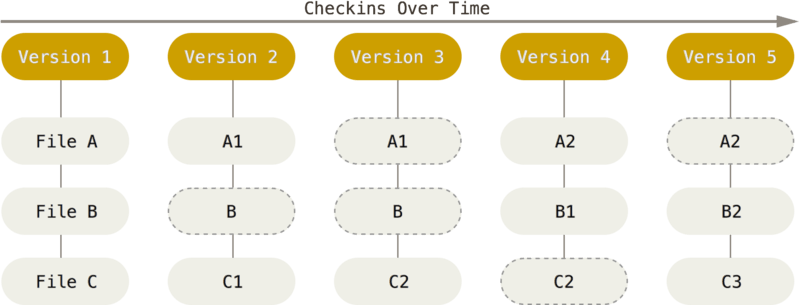
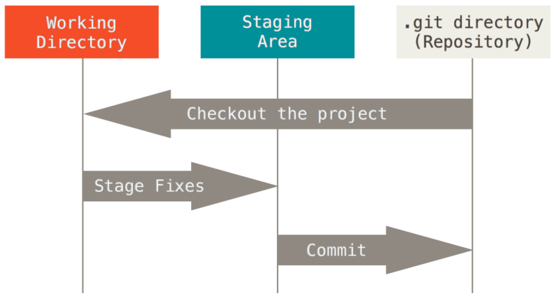
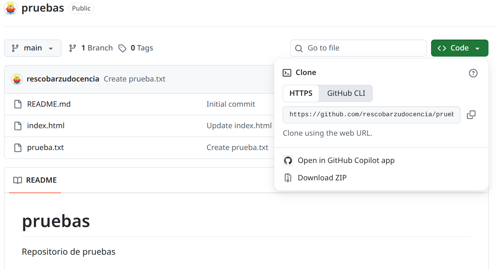
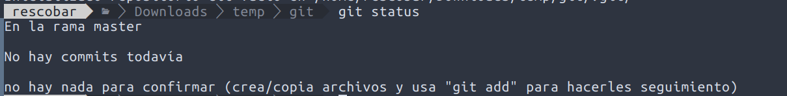
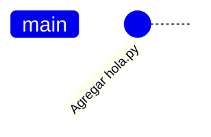
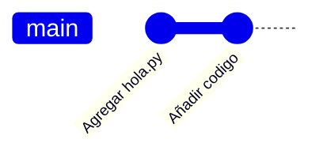
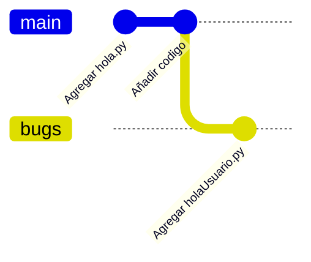
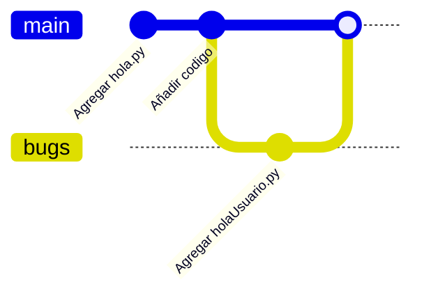

# UT5 Control de Versiones. GIT. <!-- omit in toc -->
---


- [1. Introducción.](#1-introducción)
- [2. Estados de los ficheros en Git.](#2-estados-de-los-ficheros-en-git)
- [3. Aspectos básicos.](#3-aspectos-básicos)
  - [3.1. Instalación de Git.](#31-instalación-de-git)
  - [3.2. Configurando Git por primera vez.](#32-configurando-git-por-primera-vez)
  - [3.3. ¿Cómo obtener ayuda?](#33-cómo-obtener-ayuda)
- [4. Uso básico de Git.](#4-uso-básico-de-git)
  - [4.1. Como crear un repositorio.](#41-como-crear-un-repositorio)
  - [4.2. Clonado de un repositoro.](#42-clonado-de-un-repositoro)
  - [4.3. Guardando datos en el repositorio.](#43-guardando-datos-en-el-repositorio)
  - [4.4. Ignorando archivos.](#44-ignorando-archivos)
- [5. Ramas.](#5-ramas)
  - [5.1. Trabajando con Ramas.](#51-trabajando-con-ramas)


# 1. Introducción.

Esta documentación es un resumen de la documentación oficial de Git y un talled del Aula de Software Libre de la Universidad de Cordoba.

[Documentación oficial de Git](https://git-scm.com/book/es/v2)

[Taller de Git del aula del software Libre de la Universidad de Cordoba](https://aulasoftwarelibre.github.io/taller-de-git/)


¿Qué es un control de versiones, y por qué debería importarte? Un control de versiones es un sistema que registra los cambios realizados en un archivo o conjunto de archivos a lo largo del tiempo, de modo que puedas recuperar versiones específicas más adelante. Aunque en los ejemplos  vamos a ver archivos de código fuente como aquellos cuya versión está siendo controlada, en realidad **puedes hacer lo mismo con casi cualquier tipo de archivo** que encuentres en una computadora.

Git maneja sus datos como un conjunto de copias instantáneas de un sistema de archivos miniatura. Cada vez que confirmas un cambio, o guardas el estado de tu proyecto en Git, él básicamente toma una foto del aspecto de todos tus archivos en ese momento y guarda una referencia a esa copia instantánea. Para ser eficiente, si los archivos no se han modificado Git no almacena el archivo de nuevo, sino un enlace al archivo anterior idéntico que ya tiene almacenado. Git maneja sus datos como una secuencia de copias instantáneas.



# 2. Estados de los ficheros en Git.

Git tiene tres estados principales en los que se pueden encontrar tus archivos: modificado (modified), preparado (staged) y confirmado (committed)

+ **Modificado**: significa que has modificado el archivo pero todavía no lo has confirmado a tu base de datos. 
+ **Preparado**: significa que has marcado un archivo modificado en su versión actual para que vaya en tu próxima confirmación.
+ **Confirmado**: significa que los datos están almacenados de manera segura en tu base de datos local. 



El flujo de trabajo básico en Git es algo así:

1. Modificas una serie de archivos en tu directorio de trabajo.

2. Preparas los archivos, añadiéndolos a tu área de preparación.

3. Confirmas los cambios, lo que toma los archivos tal y como están en el área de preparación y almacena esa copia instantánea de manera permanente en tu directorio de Git.

# 3. Aspectos básicos.

## 3.1. Instalación de Git.

+ **Instalación Linux**.
  
  Dependiendo de la distribución de Linux y su sistema de gestión de paquetes, en el siguiente enlace vienen los comandos para instlarlo dependiendo de la distribución que estemos usando.
  
  https://git-scm.com/install/linux

+ **Instalación windows**.

   En el siguiente enlace nos descargamos la versión de nuestro Windows:

   https://git-scm.com/install/windows

+ **Instalación en Mac**.
  
  https://git-scm.com/install/mac


Una vez instalada podemos ver la versión con el comando:
```bash
git --version
```

## 3.2. Configurando Git por primera vez.

Lo primero que deberás hacer cuando instales Git es establecer tu nombre de usuario y dirección de correo electrónico. Esto es importante porque los "commits" de Git usan esta información, y es introducida de manera inmutable en los commits que envías:

```bash
git config --global user.name "John Doe"
git config --global user.email johndoe@example.com
```

> Tu Editor

Ahora que tu identidad está configurada, puedes elegir el editor de texto por defecto que se utilizará cuando Git necesite que introduzcas un mensaje. Si no indicas nada, Git usará el editor por defecto de tu sistema, que generalmente es Vim. Si quieres usar otro editor de texto como Emacs, puedes hacer lo siguiente:

```bash
git config --global core.editor emacs
```
> Comprobando tu Configuración

Si quieres comprobar tu configuración, puedes usar el comando git config --list para mostrar todas las propiedades que Git ha configurado:

```bash
git config --list
```
También puedes comprobar el valor que Git utilizará para una clave específica ejecutando `git config <key>`.

```bash
git config user.name
John Doe
```

## 3.3. ¿Cómo obtener ayuda?
Si alguna vez necesitas ayuda usando Git, existen tres formas de ver la página del manual (manpage) para cualquier comando de Git:
```bash
git help <verb>
git <verb> --help
man git-<verb>
```
Por ejemplo, puedes ver la página del manual para el comando config ejecutando:

```bash
git help config
```

# 4. Uso básico de Git.

## 4.1. Como crear un repositorio.

Para iniciar un repositorio, debemos tener en un directorio nuestro proyecto. El directorio debe de estar creado.

El comando para inicializar y crear nuestro repositorio es:

```bash
git init
```
Nos crea un directorio oculto llamado `.git`, donde va a almacenar todo el historial de acciones vamos a ir realizando.

> Ejercicio 1

Creamos un directorio en documentos y dentro de dicho directorio inicializamos el respositorio.

> [!IMPORTANT] 
> No eliminar por ningun motivo `.git`, ya que si se elimina se perderá el historial del repositorio quedando los ficheros a la última actualización.


## 4.2. Clonado de un repositoro.

También podemos clonar repositorios de Github. Para lo cual vamos a utilizar con siguiente comando:

```bash
git clone [URL]

git clone https://github.com/libgit2/libgit2

git clone https://github.com/libgit2/libgit2 mylibgit
```
+ **URL**: es la ruta del repositorio https://github.com/usuario_github/nombre_del_repositorio


En la siguiente imagen podemos ver donde obtenemos la URL del repositorio, pulsaando sobre el botón verde Code:




## 4.3. Guardando datos en el repositorio.


> Estado de un repositorio.

Otro comando muy útil, es el que nos permite saber el estado en el que está nuestro repositorio, el area de trabajo (donde están nuestros archivos) y el área de staging (donde git guarda cambios antes de almacenarlos en el repositorio).



Aquí podemos ver que estamos en la rama master. Que aún no hemos hecho ningún commit, y que tenemos no tenemos ningún fichero para confirmar.


```bash
git status
```
> Ejercicio 2

Ejecutamos el comando y vemos que no tenemos nada aún.

> Crear nuestro primer commit

Para crear los commit necesitamos ejecutar los siguientes comandos:

1. `git add`, nos sirve para añadir los ficheros a la zona de Staging, podemos ir añadiendo ficheros con su nombre : `git add hola.py` o añadir todo con el comando `git add .`, utilizando el punto añade todos los ficheros y directorios.
2. `git commit `, para realizar el commit y añadirlos al repositorio. Se utiliza de dos formas.
   
    2\.1. Ejecutando `git commit` lo cual abrirá el editor por defecto configurado en Git, se vio en el apratado 3.2. Para indicar la descripción de nuestro commit.

    2\.2. Ejecutando `git commit -m "Descripcion del commit"`, con este comando añadimos la descripción sin que se abra el editor.


Vamos a crear un archivo, despues ejecutamos la orden para ver el estado del repositorio.

```bash
touch hola.py
git status
```
Nos aparecerá, vemos que nos indica el proximo comando a ejecutar:

```bash
En la rama master

No hay commits todavía

Archivos sin seguimiento:
  (usa "git add <archivo>..." para incluirlo a lo que será confirmado)
        hola.py

no hay nada agregado al commit pero hay archivos sin seguimiento presentes (usa "git add" para hacerles seguimiento)
```
Para añadir nuestro fichero a la zona de Stage y preararlo para el commit, podemos hacerlo de dos formas:

```bash
git add hola.py

o
git add .

Hacemos un 

git status
```
Nos mostrará:

```bash
git add hola.py
git status
En la rama master

No hay commits todavía

Cambios a ser confirmados:
  (usa "git rm --cached <archivo>..." para sacar del área de stage)
        nuevos archivos: hola.py
```
Donde nos indica que no hemos realizado el commit y que si queremos eliminar el fichero o ficheros el comando que debemos ejecutar.

Ya solo nos queda realizar el commit

```bash
git commit -m "Agregar hola.py"
git status
```
Añadimos al respositorio, mostrando lo siguiente:
```bash
git commit -m "Agregar hola.py"
[master (commit-raíz) 13c16aa] Agregar hola.py
 1 file changed, 0 insertions(+), 0 deletions(-)
 create mode 100644 hola.py
```
Graficamente se veria como se muestra el siguiente esquema:

Grafo del respositorio




> Eliminar archivos del área de Stage

`git rm --cached <archivo>...`

> Ver el Historial de commit

`git log`

Nos muestra:

```bash
git log
commit 13c16aa50445edd6718e532f2bbe965fec52e6a8 (HEAD -> master)
Author: Rafael Ernesto Escobar Zurita <rescobarzudocencia@gmail.com>
Date:   Thu Nov 26 18:43:49 2026 +0100

    Agregar hola.py

```
Vemos el ID del commit y al final el comentario que hemos añadido, con esta información podemos revertir un commit.

Este es el proceso cada vez que añadamos o modifiquemos ficheros.

1. Creamos o modificamos los ficheros en el repositorio. Zona Working.
2. Los añadimos a la zona de Stage. Comando `git add`.
3. Realizamos el Commit y pasa al repositorio. Comando `git commit`.

Vamos a seguir con nuestro repositorio vamos añadir contenido a nuesto fichero `hola.py`.

```python
print(f"Hola Mundo")
```
Una vez ejecutamos los siguientes comandos, realizados uno a uno para ver el log que va dejando.

```bash
git status
git add .
git status
git commit -m "Añadir codigo"
git status
git log
```
El ultimo comando mostrará los dos commit.
```bash 
git log
commit 1d038b45f8eb5d1df0f86446c5c16921a7f6c7ee (HEAD -> master)
Author: Rafael Ernesto Escobar Zurita <rescobarzudocencia@gmail.com>
Date:   Thu Nov 26 19:30:39 2026 +0100

    Añadir codigo

commit 13c16aa50445edd6718e532f2bbe965fec52e6a8
Author: Rafael Ernesto Escobar Zurita <rescobarzudocencia@gmail.com>
Date:   Thu Nov 26 18:43:49 2026 +0100

    Agregar hola.py
```

Grafo del respositorio



Así iremos añadiendo diferentes commit.

> Volver a un commit

Cada cambio es etiquetado por un hash, para poder regresar a ese momento del estado del proyecto se usa la orden `git checkout`.

Ejemplo:

```bash
git checkout e19f2c1
```
## 4.4. Ignorando archivos.

Existe un fichero llamado `.gitignore`.

Ejemplo:

```
.gitignore
dir1/           # ignora todo lo que contenga el directorio dir1
!dir1/info.txt  # El operador ! excluye del ignore a dir1/info.txt (sí se guardaría)
dir2/*.txt      # ignora todos los archivos txt que hay en el directorio dir2
dir3/**/*.txt   # ignora todos los archivos txt que hay en el dir3 y sus subdirectorios
*.o             # ignora todos los archivos con extensión .o en todos los directorios
```

# 5. Ramas.

Una Rama es una bifurcación que se usa cuando se va ha trabajar con una nueva funcionalidad.

La rama principal con la que trabaja Git es la `master`, pero si necesitamos resolvel Bugs o añadir nuevas funcionalidades podemos utilizar las ramas.

Cada vez que creas una rama Git crea en paralelo un entorno donde puedes añadir, modificar o borrar archivos sin que deje de funcionar la rama principal desde la cual has creado la nuerva rama. Una vez realizados las modificaciones se fusiona con la rama principal, pasando a dicha rama las nuevas modificaciones.

Ventajas:

+ Evita ducplicar carpetas.
+ Si deja de funcionar con volver a la Rama principal y borrar la creada que no funciona basta.

## 5.1. Trabajando con Ramas.

> Creando ramas.

`git branch "nombre de la rama"`

Si ejecutamos `git brach` sin nombre de la rama nos muestra las ramas de nuestro repositorio.

> Cambiando de rama.

+ `git checkout "nombre de la rama"` 
+ `git switch "nombre de la rama"` Recomendado este segundo comando.


> Creando rama y cambiando de rama en el mismo comando.

`git switch -c "nombre de la rama"`

Si no existe la rama la crea.

Vamos a crear una rama llamada **bugs**.

```bash
git switch -c bugs
git branch
```
Nos muestra:

```
git switch -c bugs  
Cambiado a nueva rama 'bugs'  
git branch  
* bugs  
 master
```
El  **asterisco** nos indica en que rama estamos

Ejecutamos los siguientes comandos:

```bash
touch holaUsuario.py
git add .
git commit -m "Agregar holaUsuario.py"
git log
```
Este ultimo comando nos muestra la siguiente información.
```
git log  
commit 952ac01764d6dad06a8d4c3fd5b7f849b95b10ef (HEAD -> bugs)  
Author: Rafael Ernesto Escobar Zurita <rescobarzudocencia@gmail.com>  
Date:   Thu Nov 26 20:24:19 2026 +0100  
  
   Agregar holaUsuario.py  
  
commit 1d038b45f8eb5d1df0f86446c5c16921a7f6c7ee (master)  
Author: Rafael Ernesto Escobar Zurita <rescobarzudocencia@gmail.com>  
Date:   Thu Nov 26 19:30:39 2026 +0100  
  
   Añadir codigo  
  
commit 13c16aa50445edd6718e532f2bbe965fec52e6a8  
Author: Rafael Ernesto Escobar Zurita <rescobarzudocencia@gmail.com>  
Date:   Thu Nov 26 18:43:49 2026 +0100  
  
   Agregar hola.py
```

Grafo del repositorio


Para ver como trabaja  el repositorio con las ramas vamos a realizar los siguientes comandos y mira el resultado:

1. Mostramos el contenido del directorio con **"ls -al"**. Vemos que solo tiene lo ficheros **hola.py** y **holaUsuario.py**.
2. Nos cambiamos de rama a la master `git switch master`o `git checkout master`.
3. Mostramos el contenido con **"ls -al"**. Vemos que solo tiene el fichero **hola.py**.
4. Volvemos a la rama `bugs`.

> Fusionando ramas

El comando `git merge` se utiliza para fusionar los cambios de una rama en otra. Cuando ejecutas `git merge`, Git combina los cambios realizados en la rama especificada con la rama actual y crea un nuevo commit de fusión. Esto significa que se crea un nuevo commit que integra los cambios de ambas ramas.

Por ejemplo, si estás en la rama `master` y quieres fusionar los cambios de la rama `bugs`, puedes hacerlo así:

```bash
git checkout master
git merge bugs
```

Grafo del repositorio



Si mostramos el contenido de la rama `master`, vemos que se ha añadido los cambios de la rama `bugs`.